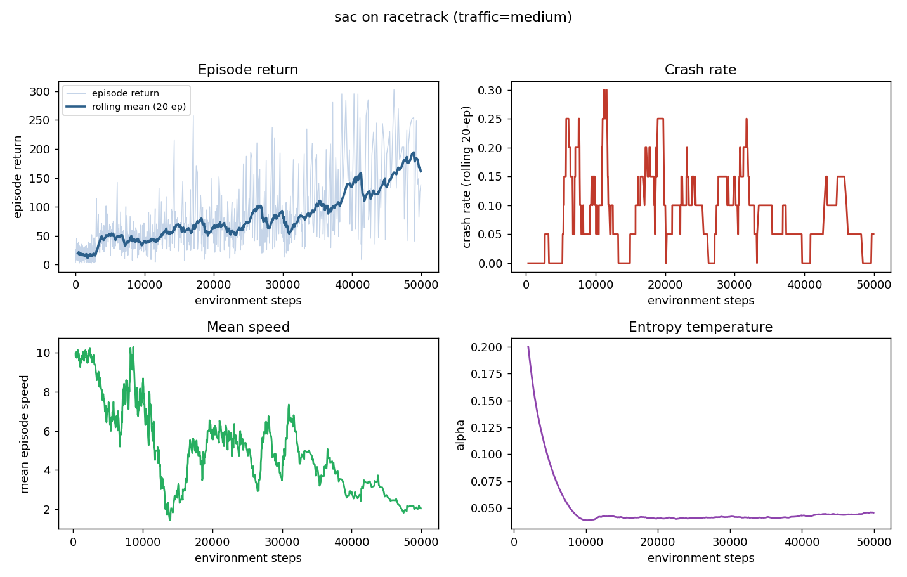
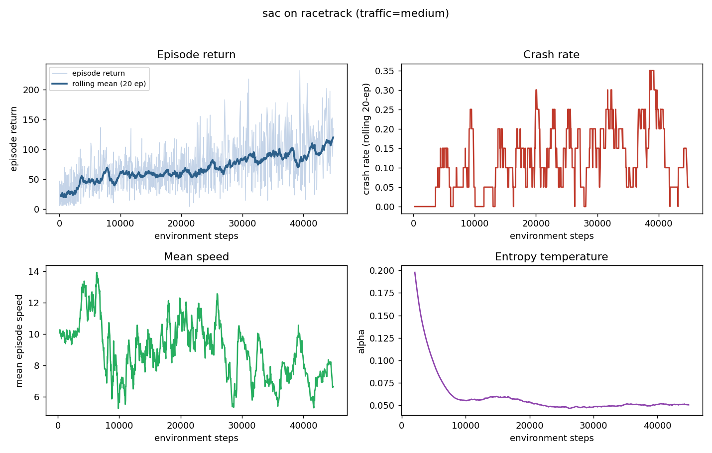
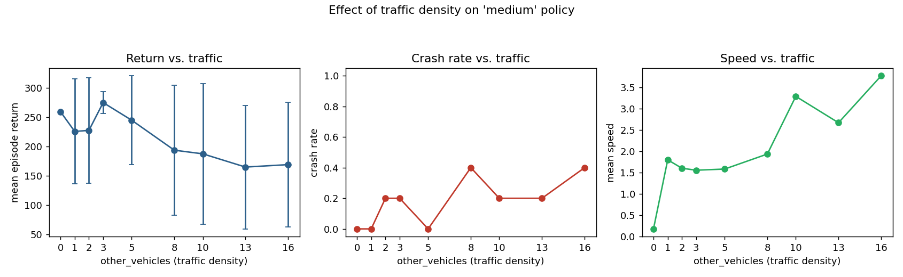
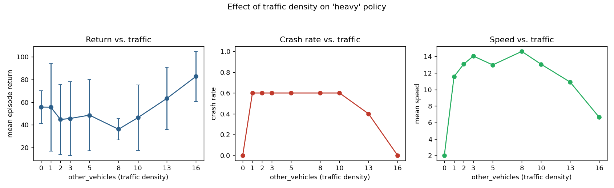

# Results & Notes: SAC on HighwayEnv `racetrack-v0`

All numbers below come from actual runs in this repo (`results/logs`,
`results/experiments`, `results/checkpoints`), not projections. Training was
done on 2 CPU cores with no GPU, which capped us at roughly 45-100
environment steps/sec depending on how many runs shared the machine, so
these are all short runs (25k-50k environment steps, seed=0 each, single
seed per condition). Treat every trend here as a qualitative,
reproducible-but-not-statistically-exhaustive finding, not a
publication-grade result — the "interesting notes" the task asked for, not a
final benchmark.

## 1. A real bug we found and fixed: `racetrack-v0` has no speed reward

The first training run (SAC, medium traffic, 50k steps) converged to an
agent that **crawls at ~1 m/s and never crashes**, with return steadily
*increasing* over training while speed steadily *decreased*:



We initially configured the env with a `high_speed_reward` key, copying the
pattern from `highway-v0`/`intersection-v0`. It turns out `RacetrackEnv`'s
`_rewards()` (in `highway_env/envs/racetrack_env.py`) only implements four
terms:

```python
{
    "lane_centering_reward": 1 / (1 + lane_centering_cost * lateral**2),
    "action_reward": np.linalg.norm(action),   # penalizes *any* actuation
    "collision_reward": self.vehicle.crashed,
    "on_road_reward": self.vehicle.on_road,     # multiplicative gate
}
```

There is no speed term at all, and `action_reward`'s coefficient is
*negative* in the default config, so it actively penalizes accelerating or
steering. Combined with a fixed-duration (time-based, not distance-based)
episode, the optimal policy under this reward is: park yourself in the lane
center, barely move, and collect `lane_centering_reward ≈ 1` every step for
the full 300-step episode. That is exactly what we observed (episode return
plateaus around 250-300 ≈ 1.0 × ~280 steps).

**Fix**: `rl_platform/envs/wrappers.py::HighSpeedRewardWrapper` adds an
explicit `coef * clip(speed / speed_limit, 0, 1.2)` bonus per step, gated to
zero off-road so the agent can't farm it by cutting corners. We re-ran the
same medium-traffic setup with a stronger speed coefficient (0.4 → 1.2) and
a softer collision penalty (-5 → -3, since an overly harsh collision penalty
combined with any real speed reward still net-favors excessive caution):



Speed now oscillates in a healthy 5-14 m/s band instead of collapsing
to ~1 m/s, while return still trends upward and the entropy temperature
(`alpha`) anneals and stabilizes normally in both cases — the underlying SAC
implementation was learning correctly the whole time; it was optimizing an
under-specified reward.

**Takeaway for anyone extending this repo**: `racetrack-v0`'s default reward
is a lane-keeping reward, not a racing/speed reward. If you want an agent
that actually drives fast, you need `HighSpeedRewardWrapper` (or a bigger
redesign such as a per-step time penalty or a progress-along-track reward).
We kept both reward configurations available via `--high-speed-reward
--collision-reward --action-reward` in `scripts/train.py` and refer to them
below as **v1** (original/buggy, `high_speed_reward=0.4` as a no-op env key,
`collision_reward=-5`) and **v2** (fixed, `high_speed_reward=1.2` via the
wrapper, `collision_reward=-3`, `action_reward=-0.05`).

## 2. A rendering bug we found and fixed: headless video export was silently blank

HighwayEnv's `EnvViewer` disables all drawing whenever
`SDL_VIDEODRIVER=dummy` is set (see its `__init__`) — presumably intended as
a training-speed optimization, since that env var is exactly what a
display-less machine needs for pygame not to crash. This meant our first
`render_mode="rgb_array"` recordings were arrays of solid zeros: no error,
just empty video. `rl_platform/envs/wrappers.py::ForceRenderEnabled` detects
this (lazily, after the viewer is constructed) and flips `viewer.enabled`
back on. There's a regression test for this
(`tests/test_env_registry.py::test_render_rgb_array_is_nontrivial`, asserting
`frame.std() > 1.0`) so this can't silently reappear.

## 3. Traffic density sweep: does the agent adapt to how much traffic there is?

We trained three "specialist" agents per reward version, each seeing a
different traffic level during training (`other_vehicles` upper bound:
`none`=0, `medium`=5, `heavy`=10 — recall HighwayEnv samples the *actual*
per-episode count as `randint(0, other_vehicles)`, so e.g. "heavy" episodes
range from 0 to 9 cars, not always exactly 10). We then evaluated every
specialist, deterministically, across a fixed sweep of traffic levels
(`other_vehicles ∈ {0,1,2,3,5,8,10,13,16}`, 5 eval episodes each) it never
saw configured that way at training time. Full numbers:
`results/experiments/traffic_sweep_v1.csv` and `traffic_sweep_v2.csv`.

### 3a. Yes — traffic density visibly changes behavior, but non-monotonically

For the **v1 "medium" specialist** (the crawling reward regime):



Speed rises from 0.18 m/s (zero traffic) to 3.77 m/s (jam, 16 vehicles) —
counter-intuitively, *more* traffic makes this agent go *faster*, not
slower. Our read: with zero traffic, sitting still in the lane center is a
strictly dominant strategy (nothing forces you to move). Once other IDM
vehicles are on the track, purely standing still is no longer safe or even
achievable (a stopped/near-stopped ego vehicle in a travel lane gets
approached and occasionally clipped by traffic, and the agent's policy
network — trained on *some* moving-traffic episodes during the medium
regime — reacts by moving). Crash rate also trends up with traffic (0 → 0.4)
as expected. Return trends down as traffic increases (more risk, plus the
per-step reward gets interrupted more often by early termination).

For the **v2 "heavy" specialist** (fixed reward):



Speed peaks near the agent's own training density (8-10 vehicles, ~13-15
m/s) and *falls* at the extremes on both sides — down to 2 m/s with zero
traffic, and down to 6.6 m/s at the 16-vehicle jam. Crash rate is elevated
(0.6) across low-to-moderate traffic but drops back to 0 at the highest jam
density, with off-road rate rising to 1.0 instead — i.e. at extreme density
the agent shifts failure mode from "crash into a car" to "get pushed off
track while avoiding cars" rather than actually driving more safely.

**So: both reward regimes show clear, traffic-dependent behavioral shifts —
but the shift is not simply "more traffic → more caution."** It's shaped by
what each agent actually experienced in training, which brings us to the
biggest and most robust finding:

### 3b. The bigger finding: specialists overfit hard to their training traffic level

This pattern is the single most consistent, most dramatic result across
*both* reward versions and *all three* traffic-specialist agents: an agent
trained at one traffic density degrades sharply — often catastrophically —
the moment it's evaluated at a different one. The clearest case is the
**"none" specialist** (trained with zero traffic, i.e. it never saw another
car):

| traffic (`other_vehicles`) | return | crash | off-road | speed |
|---|---|---|---|---|
| 0 (home condition) | 302.4 | 0.00 | 0.00 | 1.9 |
| 1 | 7.5 | 0.00 | **1.00** | 13.3 |
| 2 | 7.5 | 0.00 | **1.00** | 13.3 |
| 5 | 10.0 | 0.00 | **1.00** | 14.1 |
| 16 | 5.0 | 0.00 | **1.00** | 12.8 |

(v1 reward; the v2/fixed-reward "none" specialist shows the *identical*
qualitative collapse — 95.8 return / 0% off-road at 0 traffic vs. ~7-9
return / **100% off-road** the instant 1+ vehicle appears, at a suspiciously
consistent ~13 m/s regardless of how much traffic there is.) This agent
never learned any collision-avoidance behavior at all — it optimized purely
for lane-centering in a static world — and when a car appears in its
observation for the first time, it doesn't brake or swerve sensibly, it
just runs off the track, every single time, across 5 different traffic
levels and both reward versions. See
`results/videos/v2_none_agent_none_traffic.mp4` (clean, ~7-9 m/s driving)
vs. `results/videos/v2_none_agent_light_traffic_FAILURE.mp4` (same agent,
one car added: episodes end in 3-5 steps).

The "medium" and "heavy" specialists are more robust in absolute terms
(because HighwayEnv's `randint(0, other_vehicles)` sampling means a
"medium"-trained agent already saw plenty of 0-4-car episodes during
training), but the same shape of degradation shows up as soon as you move
away from each agent's own training regime — e.g. the v2 "medium" specialist
holds up reasonably from 0-3 vehicles (off-road jumps to 100% at just 1
vehicle, but return and crash rate stay tolerable) before crash rate climbs
to 0.6 at 13+ vehicles, well outside anything it trained on.

**Interpretation**: with this little training (25k-50k steps, single seed),
SAC in this setup is learning a policy that's well-tuned to the specific
traffic distribution it was trained under, not a general "drive safely
around cars" skill. This is a completely standard RL generalization/overfitting
result, and it's exactly the kind of thing the traffic-density
knob in this repo is designed to expose — see `scripts/traffic_experiment.py`
if you want to reproduce or extend this sweep (e.g. with a domain-randomized
agent trained across *varying* traffic per episode, which we'd expect to
generalize far better; that's a natural next experiment this architecture
supports but we didn't have compute budget to run in this session).

## 4. Continuous multi-agent live training (`scripts/live_trainer.py`)

Added after the initial batch of experiments above: a pygame dashboard that
trains several agents at once, continuously, and is safe to stop and resume
— closing the window (or Ctrl+C, or a periodic autosave) persists each
agent's network weights, optimizer momentum, replay buffer, and cumulative
step/episode counters to `results/live_checkpoints/<name>/`; running the
same command again picks every agent back up rather than restarting.

We verified this end-to-end in this same sandbox, not just in unit tests:
ran `scripts/live_trainer.py` with three agents (medium/heavy/none traffic)
for 45s (reaching 600 env steps each, 0 crashes), let it save on exit, then
ran the *identical* command again — the log confirms `[medium] resumed from
checkpoint: 600 env steps, 48 episodes already trained`, and after another
30s all three agents were at 908 steps with episode counts continuing from
where they left off (48→70, 46→68, 46→52), not reset to 0. A frame from the
second run's recorded dashboard (`results/videos/live_dashboard_run2_resumed.mp4`)
shows the HUD's `env steps: 760 (+160 this run)` — the "+N this run" bit
makes the resume visible at a glance while watching.

Implementation notes: each agent gets its own env instance and is stepped +
trained every frame (`--steps-per-frame` steps between renders, decoupling
training throughput from the display's frame rate); the window just
composes every agent's rendered panel into one grid
(`rl_platform/visualization/grid.py`) with a per-agent HUD. This required
extending `SACAgent.save`/`.load` to also persist optimizer state and the
gradient-step counter (previously weights-only, which was fine for
eval/deployment but would have silently reset Adam's momentum and the
entropy-temperature schedule on every resume), plus new `ReplayBuffer.save`/
`.load` (`.npz`) so the buffer doesn't start cold either. Both are
backward-compatible: the flat `*_final.pt` checkpoints from the batch
experiments above still load fine (as a weights-only warm start) via
`--warm-start name=path`.

## 5. Practical numbers (for anyone extending this)

- Throughput: ~50-55 env steps/sec per process on this machine's CPU
  (batch size 256, buffer 100k, 2-layer 256-unit MLPs), single-threaded
  (`OMP_NUM_THREADS=1`) to avoid oversubscription when running multiple
  training jobs at once on 2 cores.
- All 6 trained checkpoints (v1/v2 × none/medium/heavy) are in
  `results/checkpoints/*_final.pt`; raw per-episode training logs in
  `results/logs/*.csv`; the full traffic-sweep numbers in
  `results/experiments/*.csv` / `*.json`; every plot referenced above (plus
  a few more, one per agent) in `results/plots/`; demo videos with a live
  HUD overlay in `results/videos/`.
- None of these agents are close to a "solved" racetrack policy — 25k-50k
  steps is small for continuous-control SAC on a task this shaped. The
  learning curves (`results/plots/sac_*.png`) are still trending upward when
  training stops in every run. Given more compute, the natural next steps
  are: (a) train 3-5x longer per condition, (b) train one agent with
  domain-randomized traffic (sample a new density every episode) and compare
  its cross-density generalization against these fixed-density specialists,
  and (c) add a second agent architecture (e.g. TD3) via the agent registry
  to give SAC something to compete against, which the architecture already
  supports without any changes to `Trainer` or the scripts.
